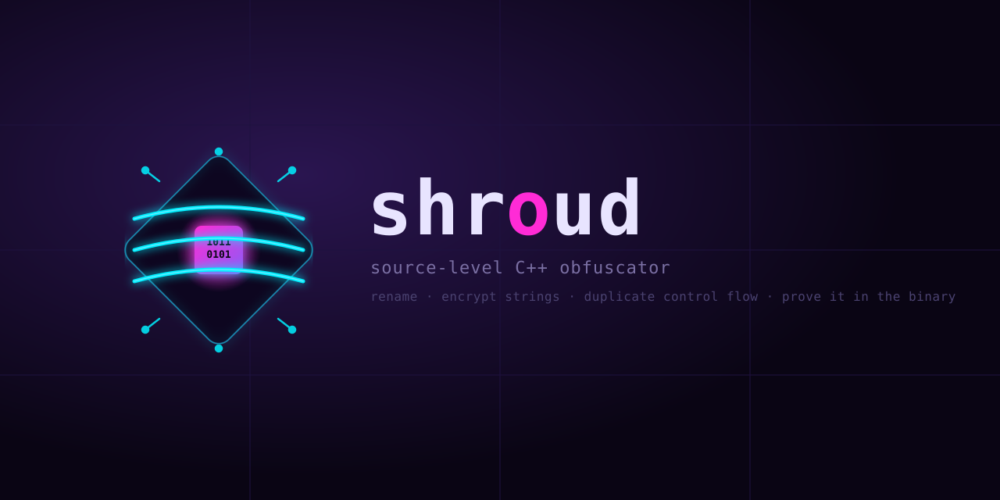

<p align="center">
  
</p>

Source level obfuscator for C++20. Renames identifiers, encrypts string
literals and duplicates statements behind opaque predicates, then proves the
result is gone from the binary.

It works on the source, not on the compiler's IR, so the same input builds with
MSVC, GCC or Clang. That is the whole point: an LLVM pass only helps LLVM users,
and MSVC projects are left out.

## Example

```
$ shroud obfuscate tests/sample/main.cpp --map build/shroud.map --seed 0x1234 -- -std=c++20
tests/sample/main.cpp -> tests/sample/main.shroud.cpp  (14 names, 17 strings, 5 branches)

$ cmake --build build && shroud verify build/app --map build/shroud.map --baseline app.orig
shroud verify
  binary   : build/app (25.1 KiB)
  map      : build/shroud.map (seed 0x00001234, 7 names, 16 strings)
  names    : 7/7 absent (6 too short to check)
  strings  : 16/16 absent
  debug    : absent
  baseline : app.orig (16.1 KiB) -> +56.3%
  result   : PASS
```

The map holds fewer names than the obfuscator reports because it stores each
distinct old spelling once, while the summary counts declarations.

`verify` exits non-zero when a checked literal or a name is still recoverable, so
it can be a CI gate. With debug info present, names are reported as inconclusive
instead of failing; strip first for a hard verdict.

## Build

Needs C++20 and libclang (any LLVM >= 16). libclang is only used to parse; the
output is plain C++.

```sh
cmake -S . -B build -DCMAKE_BUILD_TYPE=Release
cmake --build build
ctest --test-dir build --output-on-failure
```

Point `LLVM_ROOT` at the LLVM prefix if it is not in a standard place:

```sh
LLVM_ROOT=/opt/llvm cmake -S . -B build
# or: cmake -S . -B build -DSHROUD_LLVM_ROOT=/opt/llvm
```

On Windows, `libclang.dll` has to sit next to `shroud.exe` (or on `PATH`).

## Install from a release

Each tagged release attaches a self-contained package per platform
(`shroud-<tag>-<platform>.tar.gz` / `.zip`, with a `.sha256` beside it). It
bundles libclang and the clang builtin headers, and the binary finds them
relative to itself, so no LLVM install is needed on the target machine:

```sh
tar xzf shroud-v1.0.0-linux-x86_64.tar.gz
./shroud-v1.0.0-linux-x86_64/bin/shroud obfuscate app.cpp -- -std=c++20
```

The layout is `bin/`, `lib/` (libclang), `lib/clang/<ver>/include/` (the
builtin headers), `include/shroud/runtime.hpp`, and `cmake/Shroud.cmake`.
`cmake --install build --prefix dist` produces the same tree from a source
build. Pass `-resource-dir=...` after `--` to override the bundled headers.

## Usage

```
shroud obfuscate <file.cpp> [--out <file> | --in-place [--backup <suffix>]]
                            [--functions <a,b>] [--map <file>] [--seed <n>]
                            [--no-rename] [--no-strings] [--no-flow]
                            [--flow-per-function <n>] [--force]
                            [-- <compiler flags>]
shroud verify <binary> [--map <file>] [--baseline <binary>]
```

* `--out` defaults to `<stem>.shroud<ext>` **next to the input**, so relative
  `#include "..."` keeps resolving.
* Everything after `--` goes to libclang. Pass the real flags: `-I`, `-D`,
  `-std=c++20`, and on MSVC targets also the SDK include dirs.
* Parsing errors abort the run; `--force` overrides this when they live in
  headers you do not care about.
* `--seed` drives name generation and the keystream. Use a random value per
  release; the default `0` only keeps builds reproducible.
* The tool itself needs C++20. Input can be C++11 or newer, and the generated
  code still builds as C++11.

### Scope: the whole file, or only the functions you name

By default a run transforms the whole translation unit. `--functions a,b` narrows
that to the bodies of the named functions: their string literals, their
statements, their locals and parameters. Nothing outside them is edited.

```
shroud obfuscate src/license.cpp --functions verify_sig,decode --seed 0x51
```

Function names are **not** renamed in this mode (a call site may sit outside the
functions you selected), and namespace-scope declarations are left alone too —
a scoped run is weaker than a whole-file run; use it when a file must mostly
stay readable. Names are matched unqualified (`decode`, not `Codec::decode`);
overloads share a name and are all selected.

### In place

`--in-place` rewrites the input instead of writing a sibling copy:

```
shroud obfuscate src/license.cpp --in-place --backup .orig --seed 0x51
src/license.cpp  (in place, backup src/license.cpp.orig)  (6 names, 3 strings, 2 branches)
```

The original bytes are copied to `<input><suffix>` before anything is written,
and the new text goes to a temporary file renamed over the target, so a failed
write cannot leave a half-rewritten source behind. The transform is **not**
idempotent, so a second run refuses if the backup already exists or the file
already has `#include <shroud/runtime.hpp>`; `--force` overrides both. To roll
back: `mv src/license.cpp.orig src/license.cpp`.

### CMake

```cmake
include(path/to/shroud/cmake/Shroud.cmake)

shroud_obfuscate_files(OBF
    FILES app.cpp util.cpp
    SEED 0x5f3a1c
    ARGS -std=c++20 -Iinclude -DNDEBUG)

add_executable(app ${OBF})
target_include_directories(app PRIVATE ${SHROUD_INCLUDE_DIR})
```

Runs at configure time, so a changed source needs a re-configure. Every file
writes to the same map, which accumulates instead of being overwritten, because
`verify` needs the union of all translation units for the linked binary.
`shortcut: the map is never pruned` — delete it after large edits.

Then gate the build:

```cmake
add_custom_target(verify-obfuscation ALL
    COMMAND shroud verify $<TARGET_FILE:app> --map ${CMAKE_BINARY_DIR}/shroud.map
    DEPENDS app)
```

## What it does

Three independent, individually-disableable transforms:

1. **Identifier renaming** — every file-local declaration (internal or no
   linkage) gets `shd_<hash>`. Public API, class members, templates and
   anything declared in a header are never touched.
2. **String literal encryption** — `"hello"` becomes an XOR-ciphertext call
   that decodes once per call site into a static buffer; `sizeof` and
   template binding still work like a literal.
3. **Control flow duplication** — the largest statements of each function get
   wrapped in `if (::shd::opaque()) { ... } else { ... }` with identical
   behaviour, so a disassembly has two paths to read instead of one.

Each has real edge cases (macro expansions, lambda captures, `switch` bodies,
user-defined literal suffixes, `#if` branches) worked out against five real
open-source codebases. See [docs/DESIGN.md](docs/DESIGN.md) for the full
reference and the bugs each one surfaced.

## Verification

`shroud verify` scans the built binary byte by byte — no ELF/PE parser, so it
works the same on every platform. A surviving string literal or name is
**fatal**; short literals, section names and mangled symbols are excluded
because they occur in any binary by chance. It does not prove the code is hard
to reverse engineer — it proves the plaintext is not sitting in the image. Full
scanning rules: [docs/DESIGN.md](docs/DESIGN.md#verification).

## Limits, honestly

Obfuscation here is not security against a determined reverse engineer — the
XOR cipher defeats `strings(1)` and casual grep, not cryptanalysis — and a few
source positions (`__LINE__`, stringified macro arguments, names also forced
into the binary by `NS_LOG_FUNCTION`-style logging) are out of reach for a
source-level tool by construction. Full list, plus five real-project runs
(ns-3, yaml-cpp, Catch2, leveldb, jsoncpp, googletest, google/benchmark) that
shook most of these out: [docs/DESIGN.md](docs/DESIGN.md#limits-honestly).

## Prior art

| | approach | difference |
| --- | --- | --- |
| [Obfuscate](https://github.com/adamyaxley/Obfuscate), [ADVobfuscator](https://github.com/andrivet/ADVobfuscator), [Obfusk8](https://github.com/x86byte/Obfusk8) | header only, you wrap each literal by hand | shroud finds them for you; not limited to strings |
| [O-MVLL](https://github.com/open-obfuscator/o-mvll), [Hikari](https://github.com/HikariObfuscator/Hikari), Obfuscator-LLVM | LLVM pass, real control flow work | LLVM only, MSVC projects are out |
| [Tigress](https://tigress.wtf/) | C source-to-source, `--Functions=foo` per function | same scope model as `--functions`; C only, and it merges the whole program into one file |
| [spatch / Coccinelle](https://coccinelle.gitlabpages.inria.fr/website/) | semantic patch, `--dir` + `--in-place` + `--backup-suffix` | the one prior art that backs up before rewriting; general purpose, not an obfuscator |
| [clang-tidy](https://clang.llvm.org/extra/clang-tidy/) | codemod, `--fix` writes in place | no backup option at all, it trusts version control |
| [mutator/obfuscator](https://terminaldweller.github.io/mutator/obfuscator) | Clang based renamer | single file too; directory-wide input is on its roadmap |
| [CppShroud](https://github.com/Nickyangtpe/CppShroud) | random renaming of pasted text | no AST, cannot tell a name from a comment |

None of the source level tools walks a whole project: they either live inside
the compiler, take one file per run, or merge the program into one file
(Tigress). Two ideas were taken from that prior art: per-site keys instead of
one global key, and a static buffer instead of `thread_local`.

## Layout

```
include/shroud/runtime.hpp   shd::ks, shd::lit, shd::opaque (header only)
src/obfuscate.cpp            libclang walker, three transforms, edit assembly
src/verify.cpp               byte scan of the built binary
src/mapfile.cpp              shroud.map: what must not appear in the binary
src/main.cpp                 CLI
cmake/Shroud.cmake           configure-time helper for CMake projects
tests/run.sh                 baseline vs obfuscated output diff + verifier gate
tests/unit/                  CHECK()-based unit tests for the pure logic, no parsing
examples/                    one small file per transform, see the first line
docs/DESIGN.md               full edge-case reference, real-project validation history
```
